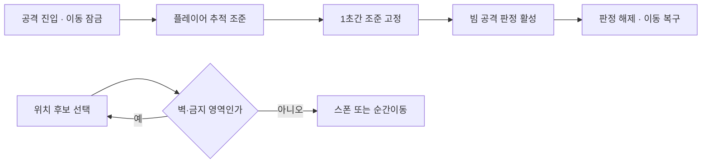

# 보스 공격 시퀀스와 유효 위치 선택

**담당자:** 최성원 — 보스 패턴·스폰 및 순간이동 확장

## 코드

**Boss1_Atk:** 추적 조준→조준 고정→발사→복구 순서로 레이저를 실행합니다. **SpawnPoint / Spawner:** 스폰 금지 영역을 피합니다. **Boss3_Atk:** 순간이동 후보에 벽이 있는지 검사합니다.



```csharp
// Boss1_Atk.Atk1: 조준·고정·발사를 명확한 시간 단계로 구분
private IEnumerator BeamAttack()
{
    float originalSpeed = boss.speed;
    boss.speed = 0f;
    boss.isAttacking = true;
    GetComponent<Rigidbody2D>().isKinematic = true;
    beamParent.SetActive(true);

    for (float time = 0; time <= shootWaitTime - 1f; time += Time.fixedDeltaTime)
    {
        Vector2 direction = GameManager.instance.player
            .GetComponent<Rigidbody2D>().position - beamRigid.position;
        float angle = Mathf.Atan2(direction.y, Mathf.Abs(direction.x)) * Mathf.Rad2Deg;
        angle = sprite.flipX ? Mathf.Clamp(180f - angle, 90f, 270f)
            : Mathf.Clamp(angle, -90f, 90f);
        beamRigid.SetRotation(angle);
        yield return new WaitForFixedUpdate();
    }

    // 마지막 1초는 조준을 고정해 플레이어가 피할 여지를 만든다.
    yield return new WaitForSeconds(1f);
    for (int i = 1; i < beams.Length; i++)
    {
        beams[i].GetComponent<Animator>().SetTrigger("Shoot");
        beams[i].gameObject.tag = "EnemyBullet";
    }
    yield return new WaitForSeconds(0.6f);
    for (int i = 1; i < beams.Length; i++)
        beams[i].gameObject.tag = "Untagged";
    beamParent.SetActive(false);
    boss.speed = originalSpeed;
    boss.isAttacking = false;
    GetComponent<Rigidbody2D>().isKinematic = false;
}

// Spawner.Spawn: 미리 배치한 후보점의 금지 상태를 확인
private Transform SelectSpawnPoint()
{
    Transform point;
    do
    {
        point = spawnPoint[Random.Range(1, spawnPoint.Length)];
    } while (point.GetComponent<SpawnPoint>().noSpawn);
    return point;
}

// Boss3_Atk.GetTeleportPoint: 벽이 없는 위치를 찾는 원본 탐색 흐름
private Vector3 GetTeleportPoint()
{
    while (true)
    {
        Vector3 point = GameManager.instance.player.transform.position
            + new Vector3(Random.Range(-8.6f, 8.6f), Random.Range(-4.6f, 4.6f), 0f);
        bool blocked = false;
        foreach (var hit in Physics2D.OverlapCircleAll(point, 0.8f))
        {
            if (hit.gameObject.layer == LayerMask.NameToLayer("Wall"))
            {
                blocked = true;
                break;
            }
        }
        if (!blocked) return point;
    }
}
```

## 생략 및 재구성한 내용

- 원본: `roxasventus/CIEN-tutorial-project-team2`, 기준 커밋: `3cf534245188b18675a8658b9c417b52f6130411`. 발췌 파일: Assets/Codes/Boss1_Atk.cs, Boss3_Atk.cs, SpawnPoint.cs, Spawner.cs.
- BeamAttack은 Atk1을 재구성한 이름입니다. 좌우 빔 초기 위치·공격 준비 Animator 트리거·효과음을 생략하고 추적·고정·판정 태그·상태 복구를 남겼습니다.
- SelectSpawnPoint는 Spawner.Spawn에 반복되던 후보 선택만 분리했습니다. SpawnPoint는 NoSpawn 트리거 진입/이탈로 noSpawn을 갱신합니다.
- 두 위치 탐색은 유효한 후보가 존재한다는 전제의 원본 반복 방식입니다. 모든 위치가 막힌 맵에서는 종료가 보장되지 않으며, 시도 횟수 제한·실패 복구가 구현돼 있다고 소개하지 않습니다.
- 순간이동 예고·이동·탄막·나머지 보스 패턴은 생략했습니다. 세 함수는 서로 다른 클래스의 발췌로 MonoBehaviour·코루틴·필드·씬 설정 없이 단독 실행되지 않습니다.
