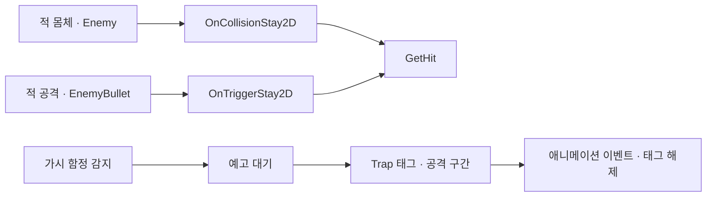

# 태그별 전투 판정과 함정 공격 구간

**담당자:** 최성원 — 전투·함정 확장 / 공통 전투 구조는 팀·학습 기반 코드 포함

## 코드

**Player:** 적 접촉과 적 공격 트리거를 분리합니다. **Trap:** 발동 감지와 실제 피해를 주는 구간을 구분합니다. 별도 물리 채널 API가 아니라 Unity 충돌 콜백과 태그를 조합하는 구조입니다.



```csharp
// Player: 적 몸체의 접촉 피해
private void OnCollisionStay2D(Collision2D collision)
{
    if (!GameManager.instance.isLive || !collision.gameObject.CompareTag("Enemy"))
        return;
    var enemy = collision.gameObject.GetComponent<Enemy>();
    float damage = enemy != null ? enemy.contactDamage
        : collision.gameObject.GetComponent<Boss>().contactDamage;
    GetHit(damage);
}

// Player: 적 투사체·지속형 공격의 피해
private void OnTriggerStay2D(Collider2D collision)
{
    if (!GameManager.instance.isLive) return;
    if (collision.CompareTag("EnemyBullet"))
        GetHit(collision.GetComponent<EnemyBullet>().damage);
}

// Trap: 감지 중 바로 피해를 주지 않고 예고 시간을 거친다.
private IEnumerator SpikeAttack()
{
    anim.SetTrigger("Detect");
    yield return new WaitForSeconds(stopTime);
    anim.SetTrigger("Attack");
    gameObject.tag = "Trap";
}

// 애니메이션 이벤트에서 유효 공격 구간 종료
public void Finish()
{
    gameObject.tag = "Untagged";
}

// Trap: 같은 함정도 상태 효과는 접촉 유지·이탈로 제어
private void OnTriggerStay2D(Collider2D collision)
{
    if (collision.CompareTag("CharBase") && type == TrapType.Lava)
        GameManager.instance.player.slowPercent = slowPercentage;
}
private void OnTriggerExit2D(Collider2D collision)
{
    if (collision.CompareTag("CharBase") && type == TrapType.Lava)
        GameManager.instance.player.slowPercent = 0f;
}
```

## 생략 및 재구성한 내용

- 원본: `roxasventus/CIEN-tutorial-project-team2`, 기준 커밋: `3cf534245188b18675a8658b9c417b52f6130411`. 발췌 파일: Assets/Codes/Player.cs, Trap.cs.
- Player와 Trap은 서로 다른 클래스의 발췌입니다. Player의 GetHit, Collider/태그·프리팹 연결, 함정 최초 감지와 Animator 연결은 생략했습니다.
- EnemyBullet의 진입 판정도 원본에 있지만 중복 예시를 줄이기 위해 유지 콜백만 남겼습니다. 피해량의 프레임 시간 반영은 원본 GetHit가 담당합니다. 실제 레이어 충돌 매트릭스를 새로 설계했다고 주장하지 않습니다.
- 포폴의 전체 판정을 이 두 스크립트로 재현하는 것은 아닙니다. Trap 태그 피해를 소비하는 플레이어 하위 컴포넌트 등 나머지 연결은 원본 씬·관련 스크립트에 의존합니다.
- 학습용 뱀서 기본 구조를 바탕으로 확장한 팀 프로젝트입니다. 공통 Player 코드 전체의 독자 설계·단독 구현을 주장하지 않습니다.
