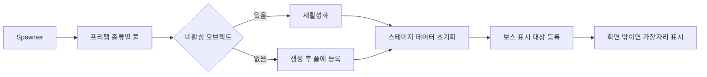

# 스폰 재사용과 화면 밖 보스 표시

**담당자:** 프로젝트 팀 — 공통 풀 구조 / 최성원 — 스폰·보스 UI 연결 확장

## 코드

**PoolManager:** 프리팹 종류별 비활성 오브젝트를 재사용합니다. **Spawner:** 보스 생성 시 표시 대상을 등록합니다. **OffScreenTargetIndicator:** 대상과 표시 오브젝트를 매핑하고 화면 밖에서만 표시합니다.



```csharp
// PoolManager.Get: 기존 비활성 오브젝트 우선, 없을 때만 새로 생성
public GameObject Get(int index)
{
    foreach (GameObject item in pools[index])
    {
        if (item.activeSelf) continue;
        item.SetActive(true);
        return item;
    }
    var created = Instantiate(prefabs[index], transform);
    pools[index].Add(created);
    return created;
}

// Spawner의 보스 분기: 현재 스테이지 데이터로 초기화하고 표시 대상 등록
private void SpawnBoss(Transform point)
{
    int stage = GameManager.instance.stageNum;
    var enemy = GameManager.instance.pool.Get(9 + stage);
    enemy.transform.position = point.position;
    enemy.GetComponent<Boss>().Init(spawnData[stage]);
    GameManager.instance.targetManager.AddTarget(enemy);
}

// OffScreenTargetIndicator: 보스마다 표시 오브젝트를 연결
private Dictionary<GameObject, GameObject> targetIndicators = new();
public void AddTarget(GameObject target)
{
    targetIndicators.Add(target, Instantiate(indicatorPrefab, transform));
}

// 매 프레임 등록된 대상만 순회한다. 전체 씬의 적을 검색하지 않는다.
private void Update()
{
    if (!GameManager.instance.isLive) return;
    foreach (var pair in targetIndicators)
        UpdateTarget(pair.Key, pair.Value);
}

private void UpdateTarget(GameObject target, GameObject indicator)
{
    Vector3 position = _camera.WorldToViewportPoint(target.transform.position);
    bool outside = position.x <= 0 || position.x >= 1
        || position.y <= 0 || position.y >= 1;
    indicator.SetActive(outside);
    if (!outside) return;

    Vector3 margin = _camera.WorldToViewportPoint(new Vector3(spriteWidth, spriteHeight, 0))
        - _camera.WorldToViewportPoint(Vector3.zero);
    position.x = Mathf.Clamp(position.x, margin.x, 1 - margin.x);
    position.y = Mathf.Clamp(position.y, margin.y, 1 - margin.y);
    Vector3 world = _camera.ViewportToWorldPoint(position);
    world.z = 0;
    indicator.transform.position = world;
    Vector3 direction = target.transform.position - world;
    indicator.transform.rotation = Quaternion.Euler(0, 0,
        Mathf.Atan2(direction.y, direction.x) * Mathf.Rad2Deg);
}
```

## 생략 및 재구성한 내용

- 원본: `roxasventus/CIEN-tutorial-project-team2`, 기준 커밋: `3cf534245188b18675a8658b9c417b52f6130411`. 발췌 파일: Assets/Codes/PoolManager.cs, Spawner.cs, OffScreenTargetIndicator.cs.
- PoolManager는 팀·학습용 공통 구조이며 전체 알고리즘을 개인 독자 구현으로 주장하지 않습니다. Awake에서 프리팹 수만큼 빈 리스트를 만드는 부분을 생략했습니다.
- SpawnBoss는 Spawner.Spawn의 보스 분기 일부를 설명용으로 분리한 이름입니다. 위치 후보 선택·경고 UI·효과음은 다른 샘플 또는 원본에 있습니다.
- 풀 반환은 관련 컴포넌트에서 SetActive(false)로 수행합니다. 타입별 Init·OnEnable 초기화와 리스트 초기화·필드 선언은 생략했습니다.
- 인디케이터는 직교 2D 카메라 구성을 전제로 합니다. 대상 해제 시 원본 RemoveTarget은 딕셔너리 항목만 제거하므로 표시 오브젝트 해제까지 완결된 수명 관리라고 소개하지 않습니다.
- 서브 프로젝트 양식에서는 Optimization 항목을 표시하지 않습니다. 이 문서는 현재 표시되는 스폰·전투 UI 기여의 보조 코드이며 숨겨진 최적화를 다시 포폴에 추가하지 않습니다.
